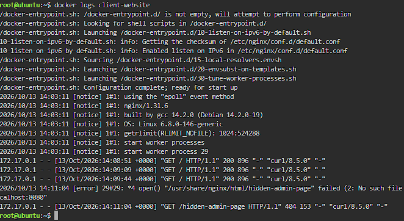
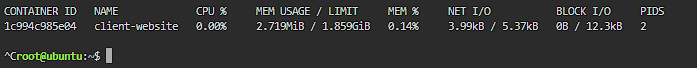

# Container Observability

## 404 Error Log

```
172.17.0.1 - - [13/Oct/2026:14:11:04 +0000] "GET /hidden-admin-page HTTP/1.1" 404 153 "-" "curl/8.5.0" "-"
```



## Why Application Logs Matter

Application logs record every request and the answer the server gave. When something breaks, they show what happened and when, so I can find the cause faster.

## Container Metrics

| Item | Value |
|---|---|
| Container | client-website |
| CPU Usage | 0.00% |
| Memory Usage | 2.719MiB |


