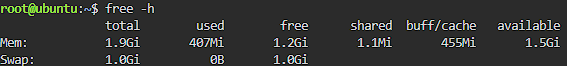
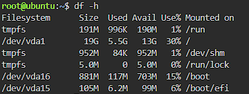

# System Baseline Report

## Host Baseline Values

| Item | Value |
|---|---|
| Total RAM | 1.9 GiB |
| Total storage of root (/) | 19 GB |

## Screenshots

## Why Disk Space Matters

Checking disk space before a traffic surge is critical because a full disk can stop the server from saving logs and data, which can crash the application.
