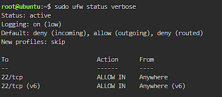
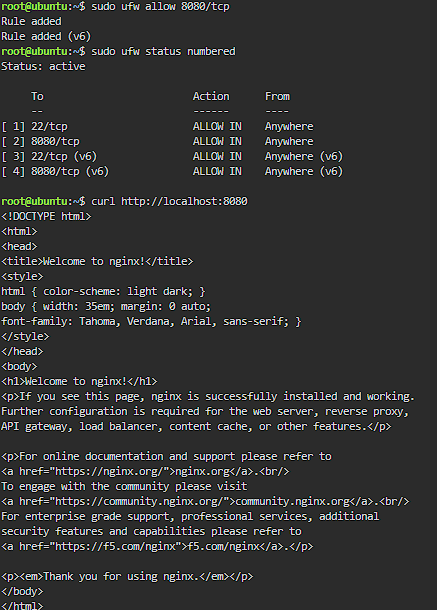

# Firewall Configuration

## Commands Used

**Allow SSH**
```bash
sudo ufw allow ssh
```

**Set the Default Deny policy**
```bash
sudo ufw default deny incoming
sudo ufw default allow outgoing
```

**Turn on the firewall**
```bash
sudo ufw enable
```

**Allow Port 8080**
```bash
sudo ufw allow 8080/tcp
```

## Screenshots




## What If I Ran `ufw enable` Before `ufw allow ssh`?

The firewall would block all incoming traffic, including SSH, so I would be locked out of my own server.
