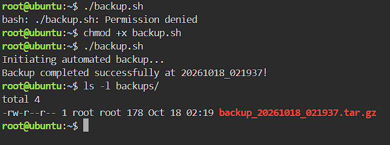
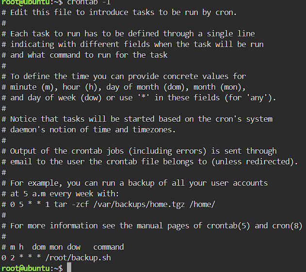

# Backup Script Guide

## The Script (backup.sh)

```bash
#!/bin/bash
# Automated Backup Script for CloudNova Technologies
SOURCE_DIR="app-data"
BACKUP_DIR="backups"
TIMESTAMP=$(date +"%Y%m%d_%H%M%S")
echo "Initiating automated backup..."
# Create the backup directory if it does not exist
mkdir -p $BACKUP_DIR
# Compress the source directory into a tarball (.tar.gz)
tar -czf $BACKUP_DIR/backup_$TIMESTAMP.tar.gz $SOURCE_DIR
echo "Backup completed successfully at $TIMESTAMP!"
```

## What `chmod +x` Does

The `chmod +x backup.sh` command adds the execute permission to the file. Before this, Linux treated the script as a plain text file and showed "Permission denied". After it, the script can run as a program.

## Cron Expression

```
0 2 * * * /root/backup.sh
```

| Field | Value | Meaning |
|---|---|---|
| Minute | `0` | At minute 0 |
| Hour | `2` | At 2 AM |
| Day of Month | `*` | Every day of the month |
| Month | `*` | Every month |
| Day of Week | `*` | Every day of the week |

This runs `/root/backup.sh` every night at 2:00 AM.

## Screenshots



